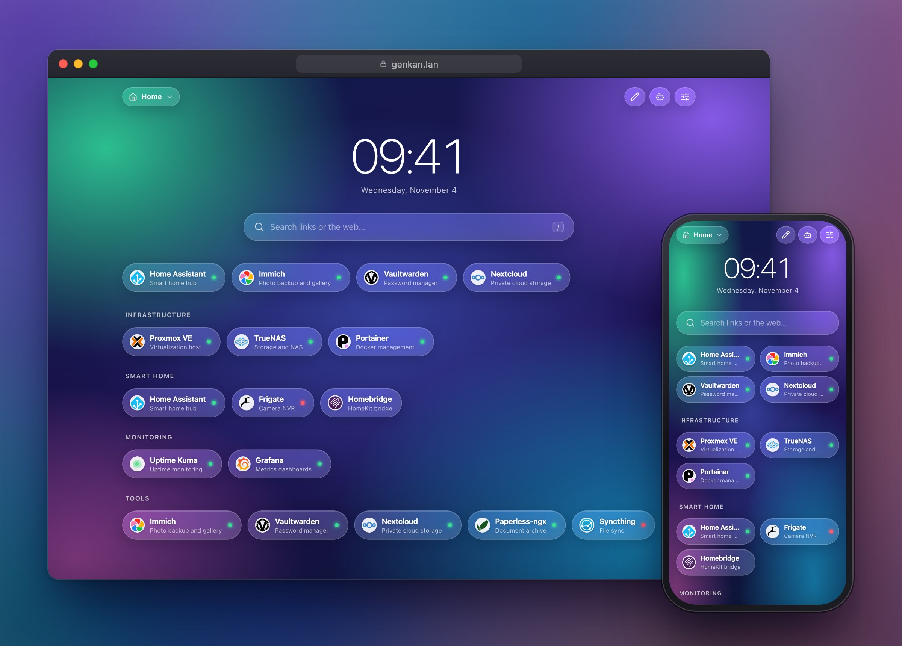
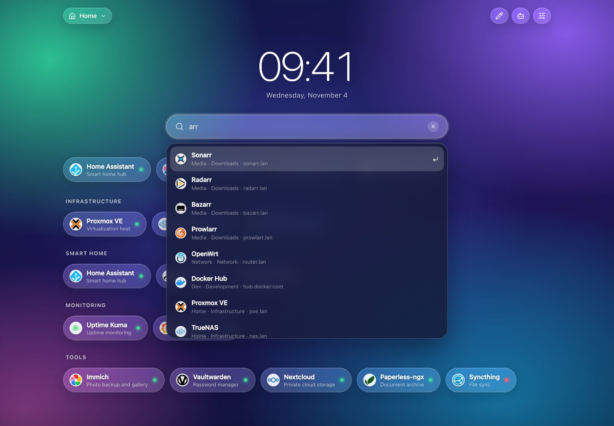
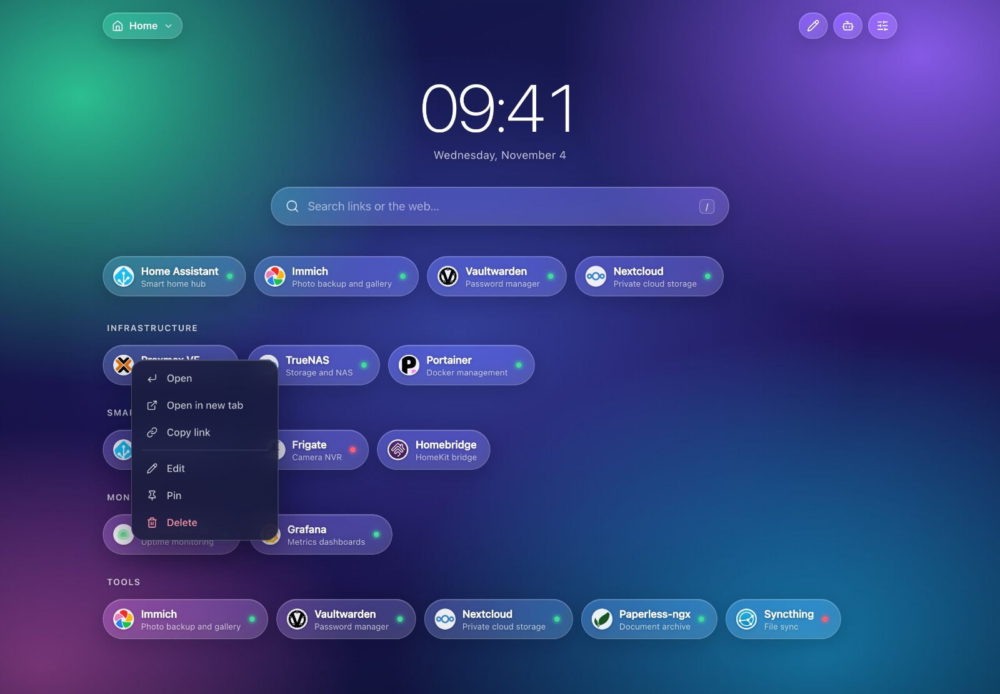
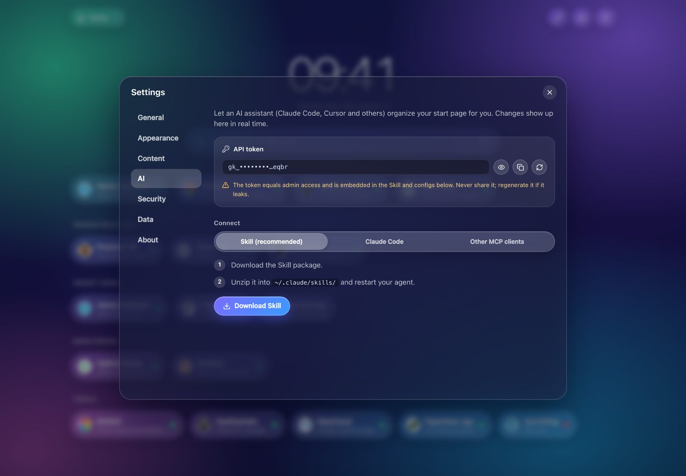
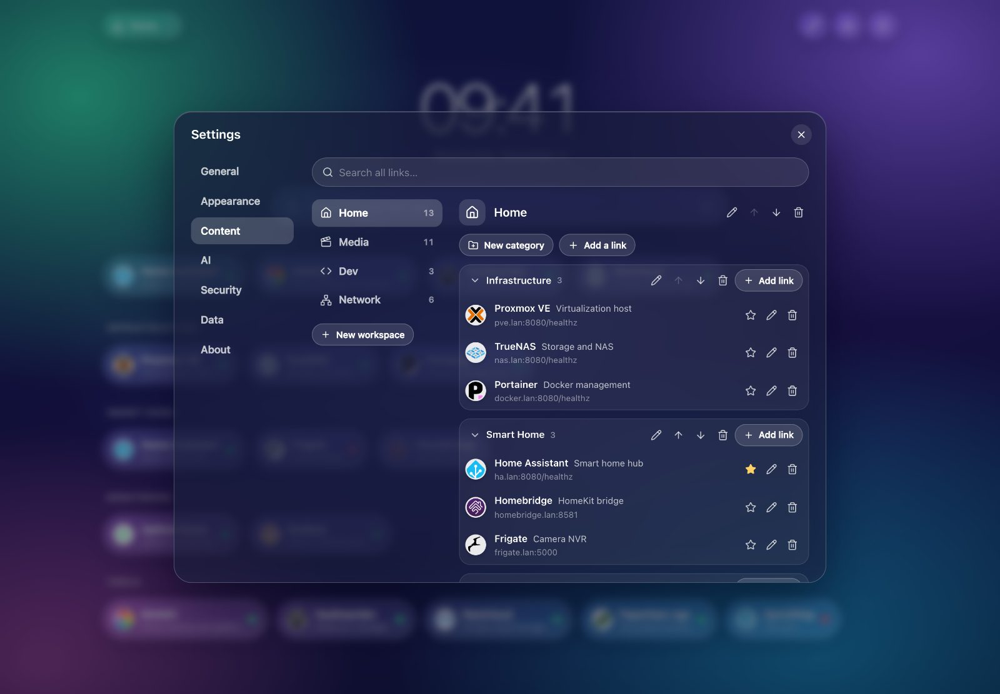

<div align="center">

# Genkan 玄関

**A lightweight, self-hosted start page for your homelab.**<br>
Wallpaper, frosted-glass capsules, and every service one click away.

[](https://github.com/jae-jae/genkan/actions/workflows/ci.yml)
[](https://github.com/jae-jae/genkan/pkgs/container/genkan)
[](LICENSE)
[](go.mod)

English | [简体中文](README.zh-CN.md)



</div>

## Why Genkan

- **Glass UI, your wallpapers.** Built-in presets plus an upload gallery; works great on desktop and phones (installable as a PWA).
- **Workspaces, categories, pins.** Pinned links show in a top row and stay in their category; 52 built-in Lucide icons for workspaces.
- **Sorted the way you like.** By frequency (default), recently used, or your own drag-and-drop order.
- **Quick search.** Press `/` or `Ctrl/⌘+K`; fuzzy match across all workspaces, with web-search fallback.
- **Knows what is up.** Optional health dots per service and automatic favicon fetching.
- **AI that actually organizes it.** Built-in [MCP](https://modelcontextprotocol.io) server and a downloadable Agent Skill; changes apply instantly and the UI updates live.
- **Private by default.** Admin login, optional read-only guest mode, no telemetry, no runtime internet dependency.
- **Tiny.** One static Go binary, `FROM scratch` image of ~11 MB, ~6 MB RAM idle, ~42 KB gzipped JS.

## Quick start

```bash
docker run -d --name genkan --restart unless-stopped \
  -p 8080:8080 -v genkan-data:/data \
  -e GENKAN_PASSWORD=change-me-please \
  ghcr.io/jae-jae/genkan:latest
```

Open <http://localhost:8080>. Without `GENKAN_PASSWORD` you are asked to set an admin password on first visit.

Or with Docker Compose (see [`docker-compose.yml`](docker-compose.yml) for a hardened example):

```yaml
services:
  genkan:
    image: ghcr.io/jae-jae/genkan:latest
    restart: unless-stopped
    ports: ["8080:8080"]
    volumes: ["genkan-data:/data"]
    environment:
      GENKAN_PASSWORD: "change-me-please"   # optional; otherwise set it on first visit
volumes:
  genkan-data:
```

Images are published for `linux/amd64` and `linux/arm64` (Raspberry Pi, Apple Silicon, NAS).

## Configuration

| Variable | Default | Description |
|---|---|---|
| `GENKAN_ADDR` | `:8080` | Listen address |
| `GENKAN_DATA` | `./data` (`/data` in Docker) | Data directory: `genkan.json` and `uploads/` |
| `GENKAN_PASSWORD` | empty | Sets the admin password on first start (min. 6 chars); never overwrites an existing one |

- Everything lives in the data directory: back it up, or use Settings → Data to export JSON.
- Behind a reverse proxy (Nginx, Caddy, Traefik), forward `X-Forwarded-Proto: https` so cookies get the `Secure` flag.
- Subcommands: `genkan version`, `genkan healthcheck` (used by the Docker `HEALTHCHECK`).

## AI integration

Genkan has a single API token (Settings → AI). Give it to an AI assistant and ask it to "sort my services into categories".

1. **Skill (recommended):** click *Download Skill*, then `unzip genkan-skill.zip -d ~/.claude/skills/`. The Skill already contains your instance URL and token.
2. **MCP:** `claude mcp add --transport http genkan http://<host>:8080/mcp --header "Authorization: Bearer <token>"` (Settings → AI shows this with your real values, plus a generic JSON snippet).

> [!WARNING]
> The token is full admin access and is embedded in the Skill and MCP snippets. Never share or commit them; regenerate the token if it leaks.

The REST API and MCP tools are described in [`docs/SPEC.md`](docs/SPEC.md).

## Screenshots

<table>
  <tr>
    <td><br><sub>Quick search across all workspaces</sub></td>
    <td><br><sub>Right-click (long-press on mobile) menus</sub></td>
  </tr>
  <tr>
    <td><br><sub>Settings → AI: token (masked), Skill, MCP</sub></td>
    <td><br><sub>Content manager for workspaces, categories and links</sub></td>
  </tr>
</table>

## Development

Requires Go 1.27+ and Node 22+.

```bash
make web      # build the frontend (embedded into the binary)
make build    # static binary -> bin/genkan
make run      # run locally with ./data
make test     # go vet + go test -race
make e2e      # Playwright suite against a throw-away Docker container
```

See [CONTRIBUTING.md](CONTRIBUTING.md) for the mock server, screenshots and PR guidelines, and [`docs/SPEC.md`](docs/SPEC.md) for the design.

## License

[MIT](LICENSE) © 2026 jae-jae

Acknowledgements: workspace icons are from [Lucide](https://lucide.dev) (ISC). Demo service logos in the screenshots come from [homarr-labs/dashboard-icons](https://github.com/homarr-labs/dashboard-icons) (Apache-2.0) and belong to their respective owners. Details in [THIRD_PARTY_NOTICES.md](THIRD_PARTY_NOTICES.md).
