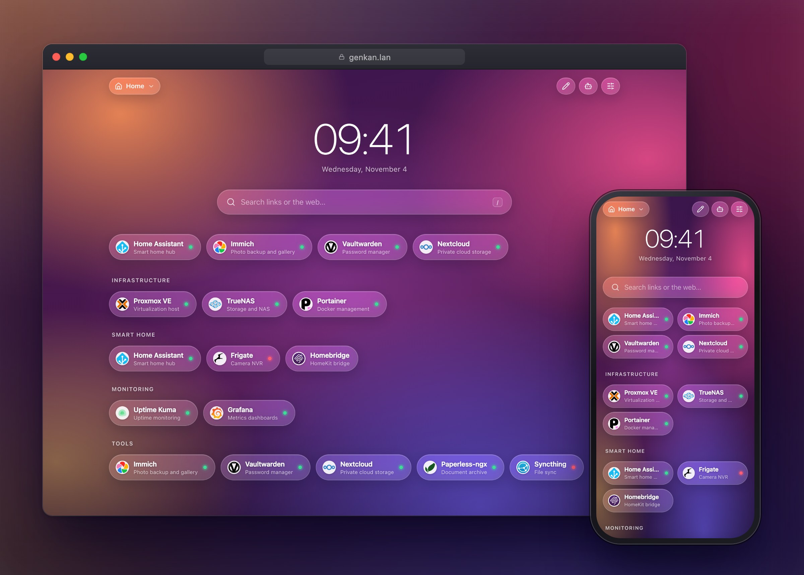
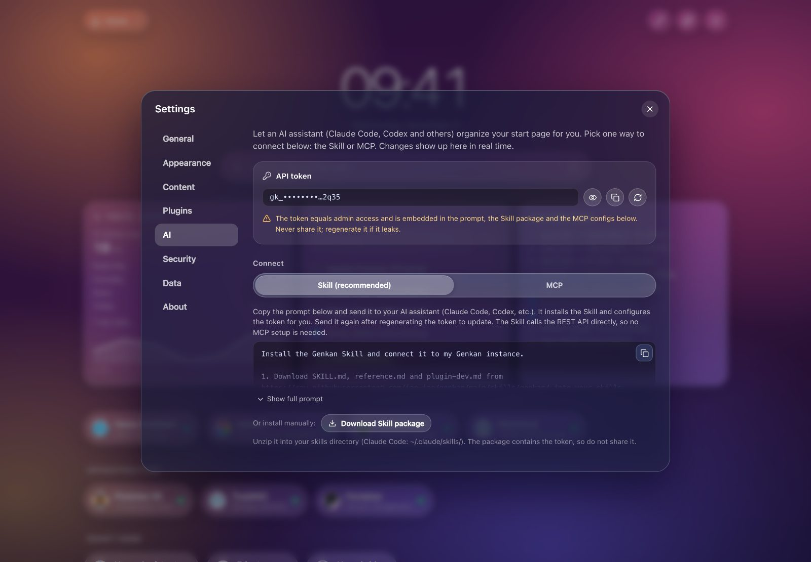
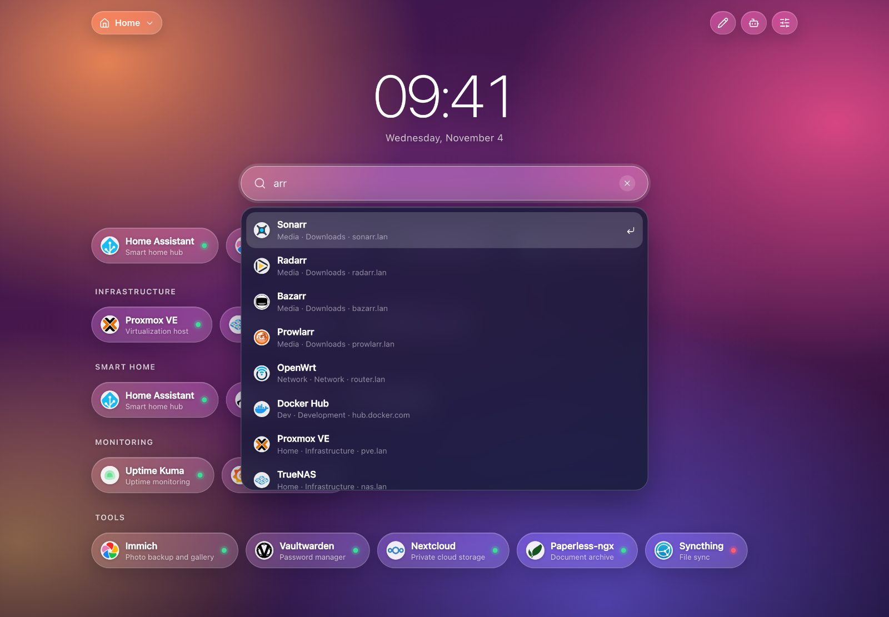
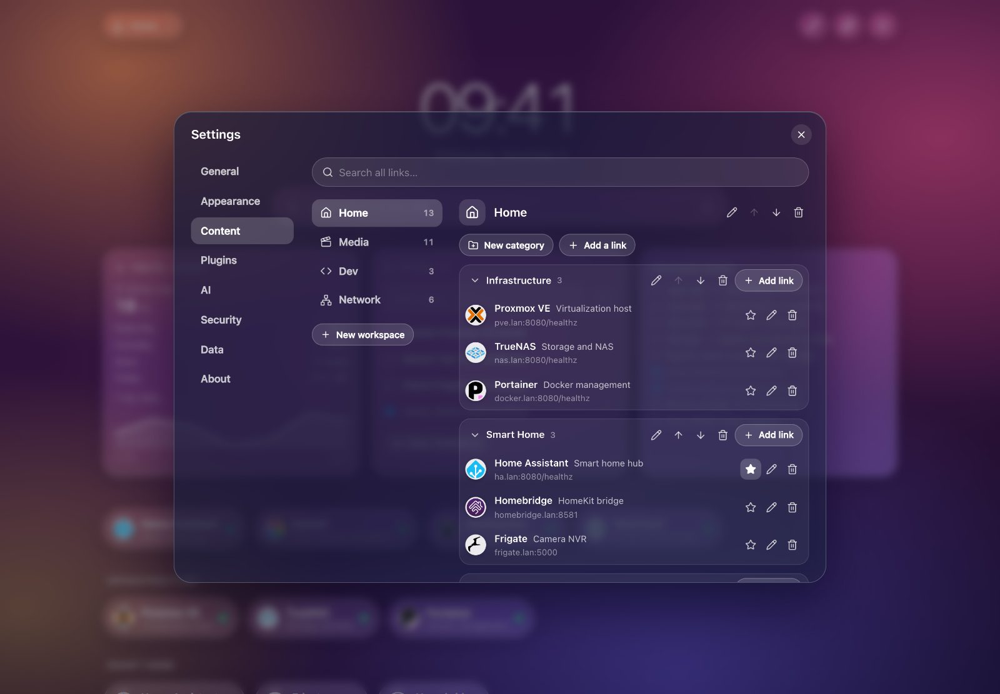
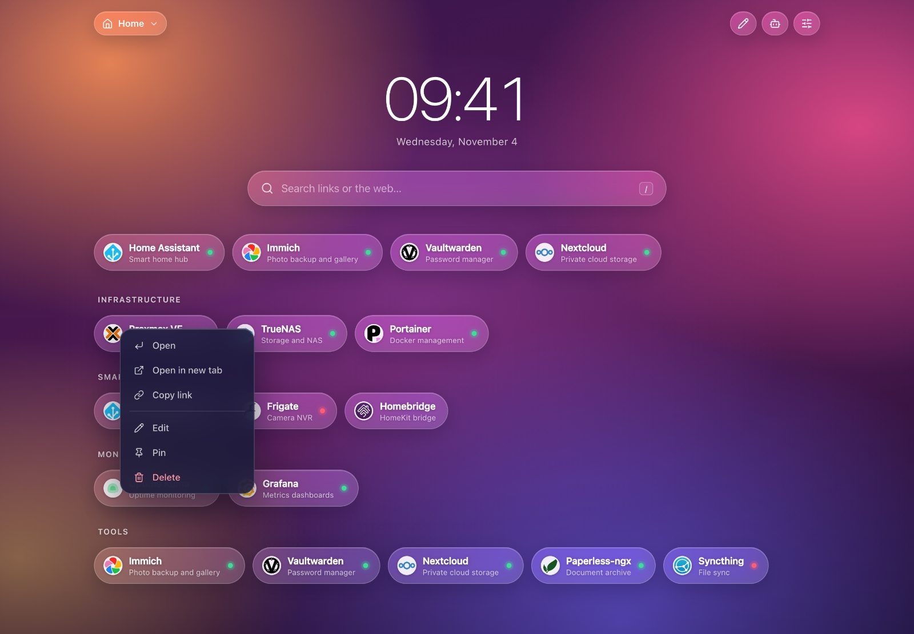

<div align="center">

# Genkan 玄関

**面向 homelab 的 AI 原生导航页。**<br>
对 AI 助手说一句话，Genkan 立即帮你整理好所有服务。壁纸 + 毛玻璃界面，约 11 MB。

[](https://github.com/jae-jae/genkan/actions/workflows/ci.yml)
[](https://github.com/jae-jae/genkan/pkgs/container/genkan)
[](LICENSE)
[](go.mod)

[English](README.md) | 简体中文



</div>

## AI 优先

Genkan 就是为 AI 助手来操作而设计的。把 Claude、Cursor 或任何 AI Agent 接上去，直接说你想要什么：

> *「把我的服务按类型分组，并置顶我最常用的五个。」*
>
> *「把 nas.lan 上的 Jellyfin、Sonarr 和 Radarr 加到 Media，并开启在线检测。」*
>
> *「找出失效的链接，移到一个“归档”分类里。」*

改动立即生效，已打开的页面实时刷新。接入 Agent 有两种互相独立的方式：Agent Skill（源码在 [`skills/genkan/`](skills/genkan)，通过 curl 直接调用 REST API，无需配置 MCP），或内置的 [MCP](https://modelcontextprotocol.io) 服务（13 个工具）；实时刷新基于 SSE，所有数据都留在你自己的服务器上。

**二选一接入**（设置 → AI 页面会给出带真实值的内容；一个 API Token 即可搞定）：

1. **Skill（推荐）：** 设置 → AI → 复制安装提示词，发给你的 AI 助手，它会自动安装 Skill 并配置 Token（也可在该页下载安装包，解压到 `~/.claude/skills/`）。
2. **MCP（备选）：** `claude mcp add --transport http genkan http://<host>:8080/mcp --header "Authorization: Bearer <token>"`（页面中也有通用 JSON 配置）。

> [!WARNING]
> Token 等同于管理员权限，且包含在安装提示词与 MCP 配置中。请勿分享或提交到代码仓库；一旦泄露请立即重新生成。

REST API（Skill 使用）与 MCP 工具说明见 [`docs/SPEC.md`](docs/SPEC.md)（中文）。

## 特性

- **AI 驱动**：通过一键 Skill（REST API）或内置 MCP 服务整理，改动实时生效
- **多工作空间**：分类、置顶链接、工作空间与链接均可选 Lucide 图标
- **界面精美**：壁纸 + 毛玻璃胶囊，桌面与手机适配
- **智能排序**：按使用频率（默认）、最近使用或自定义拖拽
- **快捷搜索**：`/` 或 `Ctrl/⌘+K`，跨工作空间，可回退网页搜索
- **插件**：用 JavaScript 插件扩展壁纸源、小组件、搜索和定时任务；插件在服务端的纯 Go 沙箱引擎（[moejs](https://github.com/MoeForge/moejs)）中运行，AI 也能为你编写并安装插件
- **在线检测**与自动图标
- **高性能 & 体积小**：单个 Go 二进制，镜像约 11 MB，内存约 6 MB
- **私有安全**：自托管，登录 + 访客只读，无遥测
- **部署简单**：Docker，amd64 / arm64

## 快速开始

```bash
docker run -d --name genkan --restart unless-stopped \
  -p 8080:8080 -v genkan-data:/data \
  -e GENKAN_PASSWORD=change-me-please \
  ghcr.io/jae-jae/genkan:latest
```

打开 <http://localhost:8080>。不设置 `GENKAN_PASSWORD` 时，首次访问会让你设置管理员密码。

或使用 Docker Compose（[`docker-compose.yml`](docker-compose.yml) 里有带安全加固的完整示例）：

```yaml
services:
  genkan:
    image: ghcr.io/jae-jae/genkan:latest
    restart: unless-stopped
    ports: ["8080:8080"]
    volumes: ["genkan-data:/data"]
    environment:
      GENKAN_PASSWORD: "change-me-please"   # 可选；不设置则首次访问时设置
volumes:
  genkan-data:
```

镜像提供 `linux/amd64` 与 `linux/arm64`（树莓派、Apple Silicon、NAS 均可）。

## 插件

插件是单个 JavaScript（或 TypeScript）文件，可以为 Genkan 增加壁纸源、首页小组件、搜索提供者（比如搜索框里的计算器）和定时任务。插件在服务端沙箱中运行（有内存与时间限制，无文件系统，只能访问插件声明且经你确认的主机），只返回声明式 JSON，浏览器不会执行任何插件代码。

在 设置 → 插件 中可一键安装内置示例（计算器、世界时钟、倒计时、天气、RSS、Pi-hole 等），也可以粘贴源码或 URL，或者让 AI 助手通过 Skill / MCP 为你编写。插件接口约定见 [`docs/PLUGINS.md`](docs/PLUGINS.md)。

## 更新

每次合并到 `main` 都会自动发布一个新版本（`vX.Y.Z`），包含新镜像和签名的二进制。Genkan 每 6 小时向 GitHub 检查一次新版本（设置 → 关于，默认开启），有新版本时管理员会在右上角看到更新按钮。在更新日志面板中可以**原地热更新**：新程序下载到数据目录，校验 ed25519 签名和校验和、备份数据后重启进入新版本；新版本启动失败会自动回滚。拉取更新的镜像始终优先于原地更新。详见 [`docs/UPDATES.md`](docs/UPDATES.md)。

## 配置

| 环境变量 | 默认值 | 说明 |
|---|---|---|
| `GENKAN_ADDR` | `:8080` | 监听地址 |
| `GENKAN_DATA` | `./data`（Docker 内为 `/data`） | 数据目录：`genkan.json` 与 `uploads/` |
| `GENKAN_PASSWORD` | 空 | 首次启动时初始化管理员密码（至少 6 位）；不会覆盖已有密码 |
| `GENKAN_UPDATE_CHECK` | 开 | 设为 `off` 完全关闭版本检查 |
| `GENKAN_SELF_UPDATE` | 开 | 设为 `off` 关闭原地更新（面板改为显示 `docker compose pull` 命令） |
| `GENKAN_GITHUB_TOKEN` | 空 | 可选的 GitHub token，用于版本检查和插件市场（提高限额） |

- 所有数据都在数据目录里：备份该目录即可，或在 设置 → 数据 中导出 JSON。
- 放在反向代理（Nginx、Caddy、Traefik）后面时，请转发 `X-Forwarded-Proto: https`，会话 Cookie 才会带 `Secure` 标记。
- 子命令：`genkan version`、`genkan healthcheck`（Docker `HEALTHCHECK` 使用）。

## 截图

<table>
  <tr>
    <td><br><sub>设置 → AI：Token（已遮罩）、Skill 提示词、MCP</sub></td>
    <td><br><sub>跨工作空间的快捷搜索</sub></td>
  </tr>
  <tr>
    <td><br><sub>内容管理器：集中管理工作空间、分类与链接</sub></td>
    <td><br><sub>右键菜单（手机上为长按）</sub></td>
  </tr>
</table>

## 开发

需要 Go 1.27+ 与 Node 22+。

```bash
make web      # 构建前端（会被打进二进制）
make build    # 静态二进制 -> bin/genkan
make run      # 本地运行，数据在 ./data
make test     # go vet + go test -race
make e2e      # Playwright 端到端测试（针对一次性的 Docker 容器）
```

mock 服务、截图生成与 PR 约定见 [CONTRIBUTING.md](CONTRIBUTING.md)，设计文档见 [`docs/SPEC.md`](docs/SPEC.md)。

## 许可证

[MIT](LICENSE) © 2026 jae-jae

致谢：工作空间与链接的内置图标来自 [Lucide](https://lucide.dev)（ISC）。截图中的示例服务图标来自 [homarr-labs/dashboard-icons](https://github.com/homarr-labs/dashboard-icons)（Apache-2.0），商标归各自所有者。详见 [THIRD_PARTY_NOTICES.md](THIRD_PARTY_NOTICES.md)。

本项目积极参与并认可 [LINUX DO 社区](https://linux.do)。
